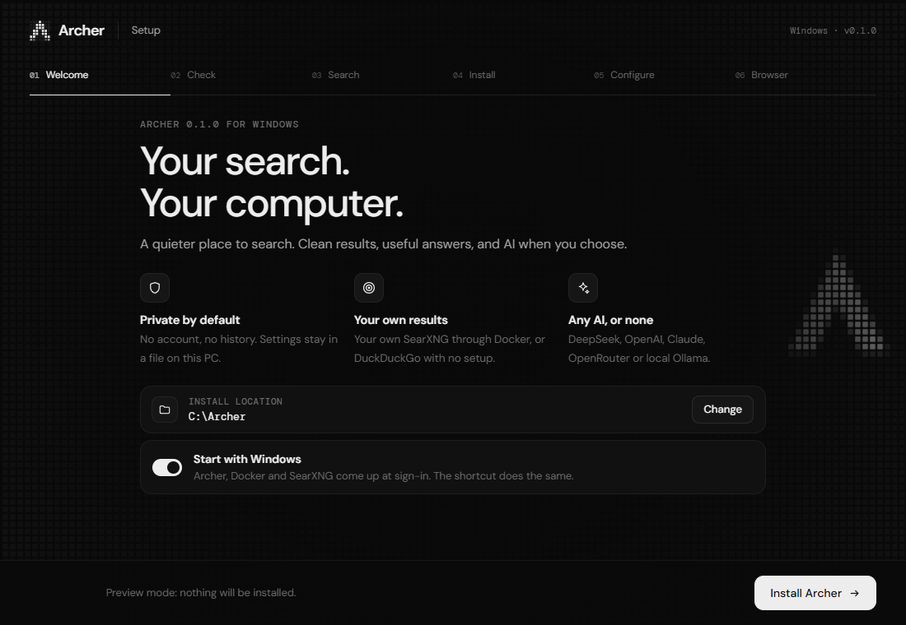
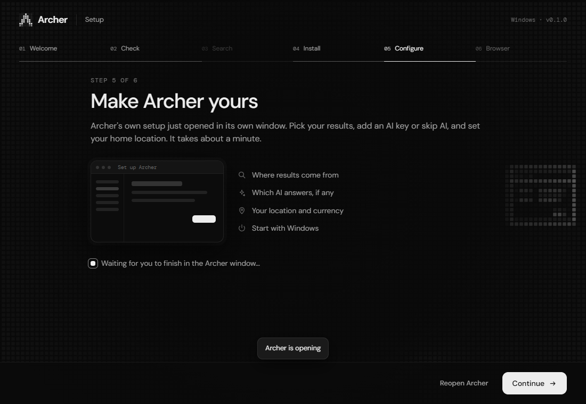
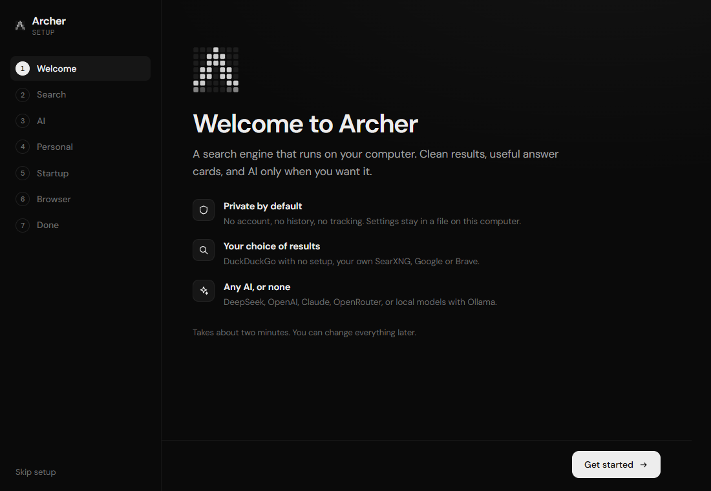
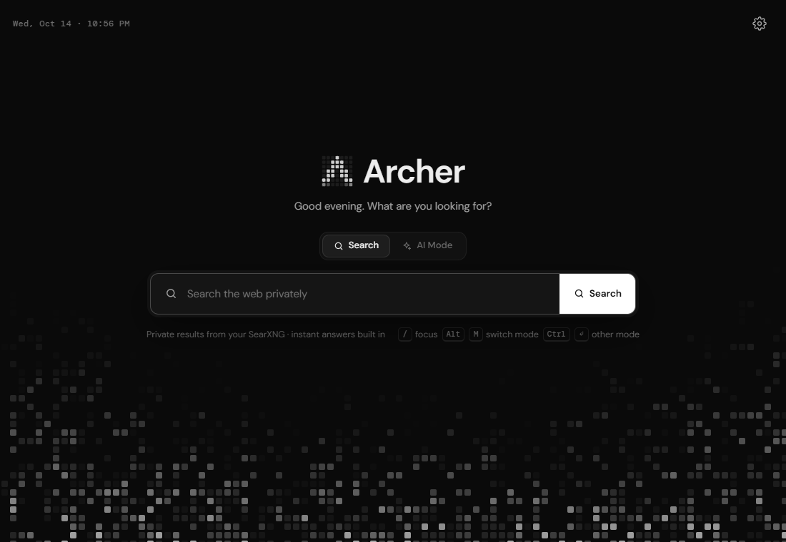

# Archer

A search engine that runs on your computer and lives in your browser's address bar. Links and
answer cards come first, and AI is added only as much as you choose. Results come from
DuckDuckGo, your own SearXNG, Google or Brave; answers from DeepSeek, OpenAI, Claude,
OpenRouter, a local Ollama model, or nothing at all. See [concept-note.md](concept-note.md) for the design.

**[Download Archer for Windows](https://github.com/Jashith127/Archer-Search/releases/download/v0.1/ArcherSetup.exe)** · [Release notes](https://github.com/Jashith127/Archer-Search/releases/tag/v0.1)



## Install (one time)

Download **ArcherSetup.exe** from [v0.1](https://github.com/Jashith127/Archer-Search/releases/tag/v0.1), then double-click it. You need Windows 10 or 11, an internet connection and at least 1 GB of free space. Setup downloads Python and dependencies through uv automatically; no separate Python or uv installation is needed.

The installer checks your PC, lets you choose the install folder and startup behavior, installs Archer, adds desktop and Start menu shortcuts, and opens the companion setup. If Docker Desktop is installed, it can set up a local SearXNG container; otherwise it uses DuckDuckGo. Docker is optional. Remove an installer-based installation through Windows **Installed apps → Archer → Uninstall**.



### Install from source

You need Windows 10 or 11 and [uv](https://docs.astral.sh/uv/). Then double-click **`install.cmd`**. It:

1. installs dependencies with `uv`,
2. adds an **Archer** shortcut to the desktop and Start menu,
3. starts Archer (a tray icon appears) and opens **setup** in the companion app.

Setup takes about two minutes, one step at a time:

| Step | What it does |
|---|---|
| Search | Choose DuckDuckGo (no setup), SearXNG (found automatically if it's running), Google or Brave, and paste a key if needed. |
| AI | Choose DeepSeek (recommended), OpenAI, Claude, OpenRouter, Ollama or a custom server, test the key, pick a model. Or skip AI. |
| Personal | Location, country, currency and language, filled in from your time zone and language. |
| Startup | Start with Windows, and what happens when it does. |
| Browser | Opens your browser's search-engine settings and gives you the values to paste. |



Browsers don't let apps change their default search engine, so the last step is three clicks:
under **Site search**, click **Add**, paste these, then choose **Make default** from the ⋮ menu.

| Field | Value |
|---|---|
| Name | `Archer` |
| Shortcut | `ar` |
| URL with %s in place of query | `http://archer.localhost:4747/search?q=%s` |
| Suggestions URL with %s in place of query | `http://archer.localhost:4747/suggest?q=%s` |

In Firefox, open Archer's home page, right-click the address bar and choose **Add “Archer”**.

Archer also shows suggestions in its home and results search boxes. Type at least
two characters, then use the arrow keys and Enter, or click a suggestion. Escape
restores what you typed; Tab dismisses the list. Searches retain the selected result
type (Images, News, or Videos).

## Search providers

| Provider | What you need | How Archer gets results |
|---|---|---|
| DuckDuckGo | Nothing | DuckDuckGo has no official web-results API, so Archer reads its HTML-only page and the JSON its own image, news and video tabs use. Works out of the box; heavy use can be rate-limited. |
| SearXNG | A SearXNG instance (Docker) | Its JSON API. Most private; combines many engines. Archer can `docker start` its container at launch. |
| Google | A [Serper](https://serper.dev) key (2,500 free searches), or an existing Programmable Search key + engine ID | Google closed its Custom Search JSON API to new customers and turns it off on 1 January 2027, so new users go through Serper. |
| Brave Search | A [Brave Search API](https://api-dashboard.search.brave.com) key | Brave's official API, with a small monthly credit. |

If your provider fails (down, rate-limited or out of credit), Archer shows DuckDuckGo's results
and says so; turn this off under **Search → Fall back to DuckDuckGo**. Categories a provider
doesn't offer (news and videos with a Programmable Search key) also come from DuckDuckGo.
`!bangs` go to SearXNG when it's your provider and to DuckDuckGo otherwise.

Suggestions follow the provider by default: SearXNG's autocomplete, Google's or DuckDuckGo's
(Brave uses DuckDuckGo's). Neither Google nor DuckDuckGo needs a key for them. Partial queries
are sent as you type; responses are cached briefly in memory, with no saved search history.
Choose another source, or turn suggestions off, under **Search → Suggestions from**.

## Daily use



- The **Archer** shortcut opens the companion app, starting Archer first if needed.
- When Windows starts it, Archer stays in the tray unless you chose otherwise under **Startup**.
- The tray menu has **Open Archer** (the companion app), **Search**, **Start with Windows**,
  **Restart** and **Quit**. Address-bar searches don't work while Archer isn't running.
- `uninstall.cmd` stops Archer and removes its shortcuts and the autostart entry.

## The companion app

Open it from the Start menu, the tray, the sliders icon on the results page, or
`http://archer.localhost:4747/app`. It opens as its own window.

- **Overview:** what's running, today's AI spend, a search box, and **Run setup again**.
- **Search:** provider, keys, fallback, SafeSearch, results language and suggestions.
- **AI:** AI on or off, Classic or Balanced by default, provider, key, model, research depth,
  and spending limits with today's usage.
- **Personal:** home location, country, currency and the contact Wikipedia requires, with **Detect**.
- **Startup:** Start with Windows, what happens at sign-in (tray, companion or search), a delay
  after sign-in, a ready notification, SearXNG's Docker container, port and address, and restart.
- **Browser:** your installed browsers (default first), each with a button that opens its
  search-engine settings, plus the values to paste.
- **Connections:** the optional TMDB key for where-to-watch listings.
- **Privacy & data:** the folders Archer uses, what leaves your computer, and clearing AI conversations.

Changes are saved to `.env` in the Archer folder, keeping its comments, and apply immediately.
Only the port and address need a restart, which the app can do for you. Keys are never sent
back to the page: it shows whether one is set and its last four characters. **Test** buttons
check AI keys, TMDB and SearXNG through free endpoints (model lists, configuration). Search-API
tests run one query, and the button says so. A value set as a system environment variable
overrides `.env` and appears read-only.

## AI search

Pick a provider on the companion app's **AI** page, paste its key and click **Test** (it lists
your models for free). DeepSeek is recommended; its default model is `deepseek-flash`.
Keys stay on this computer; never paste one into a query or commit `.env`.

| Provider | What you need | Notes |
|---|---|---|
| DeepSeek (recommended) | API key | Cheapest cited answers; built-in price ceilings. |
| OpenAI | API key | Default `gpt-5-mini`; reasoning models run at low effort so answers fit the output cap. |
| Claude | Anthropic API key | Default `claude-haiku-5-5`; native Messages API with a cached system prompt. |
| OpenRouter | API key | Any model it lists; default `openrouter/auto`. |
| Ollama | Ollama running locally | Free and private. Uses Ollama's native API so the context window (default 16,384 tokens) isn't silently truncated. Models that can't call tools skip research planning. |
| Custom | Address, model, optional key | Any OpenAI-compatible server (LM Studio, vLLM, llama.cpp, Groq…). JSON is asked for in the prompt rather than JSON mode. |

Spending caps price DeepSeek, OpenAI, Claude and OpenRouter models from list prices (OpenRouter's
public price list, cached daily); local Ollama costs nothing. Unknown models keep the token cap
only, or set prices yourself under **Spending limits → Pricing**.

On the first page of **All** results, choose **Balanced** or **AI** in the mode switch, or use
the **Quick answer** / **AI Mode** prompt shown above question-like searches. Balanced answers
appear as a card above the results, with images from the same search; they start small
(change that in the companion app's AI page) and expand with **Show full answer**. **Go deeper in AI Mode**
continues in a full-page workspace with research steps, a source rail, comparisons and
follow-ups. **All results** returns to the results page without stopping the conversation;
**Classic** stops it. Open `/ai` to begin a new conversation. Visiting or reloading that page
does not start a paid generation; a completed session is restored from memory without another
AI call. The first use asks you to turn on cloud AI. The provider receives the question,
selected public evidence, relevant card data and follow-up context. Turn on **Answer questions
automatically** only if you want eligible questions answered after results load.
Classic remains the initial default; utilities and simple entity cards don't need AI.

AI mode can search for missing evidence, retrieve source-linked image/video galleries,
read public pages, resolve and compare entities,
check forecasts and nearby places, verify regional viewing providers when a TMDB key is
configured, and calculate arithmetic, unit conversions and loan payments. It can request
forecast, place, entity, provider and editable calculation cards, alongside cited comparison
tables. **Compare sources** lets you choose two to four retrieved sources. Follow-ups
reuse the research evidence. **Stop** cancels pending work; already incurred provider usage
may still be billed. Unknown citation IDs stop the answer. A statement with an unsupported
literal quantity is omitted while other supported sections continue. These checks do not
replace checking that a source supports the full claim.

The full view includes a conversation column, source sidebar, retained follow-up turns and
a pinned multiline composer with source inspection, Research/Quick answer depth, Enter to send,
and Shift+Enter for a new line. Rounded pixel dots indicate gathering, reading and writing,
then settle on completion. Reduced-motion settings disable their animation.

Ordinary explanations use one answer call. Tool-dependent research defaults to one planning
round plus an answer; `ARCHER_AI_PLANNING_ROUNDS` allows 0–2 rounds. Only tools relevant to
the task are advertised. The final answer can use up to 5,000 output tokens (configurable
through `ARCHER_AI_ANSWER_TOKENS`); broad questions are prompted for developed sections,
lists or comparisons rather than a compact summary. Longer passages from up to ten selected
sources are provided to the answer, while the planner sees a small source inventory.

Research allows three additional web searches, two media searches,
six page reads, twelve tool calls and 75 seconds per run. Compact answers have a 12-second
deadline, one model call and up to two page reads; weather questions can also use the
existing weather adapter. Token budgets are enforced before provider calls. Aggregate
usage reservations persist in `data/ai-usage.json`; the default daily cap is 500,000 tokens,
resetting at 00:00 UTC. For the official `deepseek-flash` endpoint, built-in cache-aware
peak-price ceilings activate dollar caps and show a conservative cost estimate alongside
reported tokens and model-call count. Off-peak bills can be lower. Rates were reviewed on
14 October 2026 against [DeepSeek's pricing reference](https://api-docs.deepseek.com/quick_start/pricing/).
Set both `ARCHER_AI_INPUT_PRICE` and `ARCHER_AI_OUTPUT_PRICE` to override these rates.
Unpriced custom endpoints retain token caps and show cost as unavailable. Conservative reservations remain
for calls interrupted before final usage is reported.

Preferences live in `data/ai-preferences.json`. Query, source and answer contents stay in
bounded memory sessions and expire after 30 minutes (cleaned every 30 seconds); they are
not saved as search history. Choosing Classic disables a saved automatic Balanced default.
Turning cloud AI off stops active runs. Ordinary `GET /search` and suggestions never call
the paid provider. Automatic generation requires a saved opt-in and same-origin POST.

The public-page reader blocks private/local destinations and pins validated DNS addresses
through connection and TLS, checks redirects, and limits page size and time. It reads text
and HTML, including bounded gzip/deflate responses; PDFs, unsupported compression,
login-only and JavaScript-only pages fall back
to clearly labeled search excerpts. Source pages are untrusted data, and generated UI is
limited to Archer's validated components rather than arbitrary HTML or JavaScript.

See [the design](ai-search-design.md) for rationale. Optional GLiNER2 evaluation and
personal routing calibration remain future work; the shipped router uses conservative
rules and explicit actions.

## Development

```bash
uv sync
uv run archer --no-tray      # foreground server, Ctrl+C to stop
uv run pytest
```

Build the Windows installer with `powershell -NoProfile -ExecutionPolicy Bypass -File installer/build.ps1`. It uses Windows' .NET Framework C# compiler and embeds the current application source, lockfile, installer UI and fonts into `installer/dist/ArcherSetup.exe`. Runtime dependencies are downloaded during installation.

For an isolated installer UI check, start `installer/dist/ArcherSetup.exe --dry --no-integrate --dev-port 4791 --dir C:\Archer` and the companion fixture below, then run `node tests/installer.browser.cjs` with Playwright available. The screenshots above were captured from this preview and a fresh test configuration.

Offline browser checks (set `NODE_PATH` to a Playwright installation if needed):

```powershell
# Terminal 1: isolated sources/provider; temporary settings; no paid or public calls
uv run python tests/ai_browser_server.py
# Terminal 2
node tests/ai.browser.cjs
```

The companion app and setup on a fresh, throwaway configuration (temporary `.env` and data
folder; Start with Windows is simulated): `uv run python tests/companion_browser_server.py`,
then open `http://localhost:4790/app/welcome`.

Settings and API keys live in `.env` (see `.env.example`); the companion app edits the same file. Logs from the tray app are written to `data/archer.log`.

**Set a contact** (companion app → Personal, or `ARCHER_CONTACT` in `.env`) to an email or URL. Wikipedia and Wikidata require contact details in the User-Agent. Without them, entity panels get rate-limited or refused.
